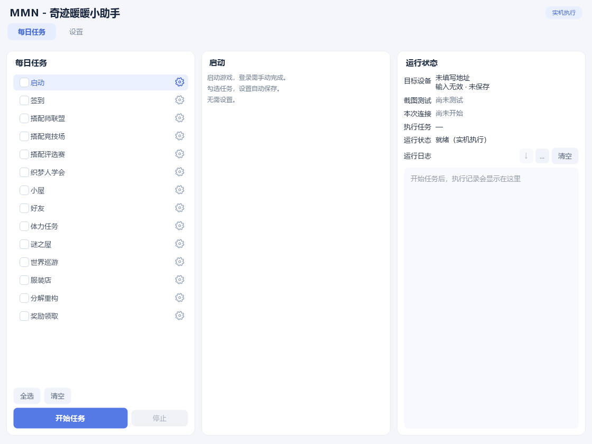

# MaaMiracleNikki Windows 使用说明

下载 [v0.1.2-rc.2 Windows 测试版](https://github.com/ccr-39/MaaMiracleNikki-Public/releases/tag/v0.1.2-rc.2)，通过中文图形界面选择《奇迹暖暖》国服日常任务。



[Windows ZIP](https://github.com/ccr-39/MaaMiracleNikki-Public/releases/download/v0.1.2-rc.2/MaaMiracleNikki-Windows-x64.zip) · [SHA256 校验文件](https://github.com/ccr-39/MaaMiracleNikki-Public/releases/download/v0.1.2-rc.2/MaaMiracleNikki-Windows-x64.zip.sha256)

校验时打开保存 ZIP 的下载文件夹，在资源管理器地址栏输入 `powershell` 并回车，执行以下命令。将输出的 `Hash` 与同版 `.sha256` 文件中的值比较，应完全一致（忽略大小写）：

```powershell
Get-FileHash .\MaaMiracleNikki-Windows-x64.zip -Algorithm SHA256
```

完整解压后，打开 MaaMiracleNikki 文件夹，双击 `MaaMiracleNikki.exe`。保留 `_internal`、`MMNUpdater.exe`、`mmn-update.json` 及其他随包文件，无需安装 Python、Node 或开发工具。不要只移动 EXE，不要在 ZIP 内直接运行。

1. 安装 MuMu 和《奇迹暖暖》国服中文客户端，开启 ADB 调试。
2. 在“设置 → 连接设置”选择模拟器自带 ADB，填写 `127.0.0.1:实际端口`；多开编号不是端口。
3. 按需开启自动连接，点击“连接与截图测试”，确认画面属于目标实例。
4. 手动完成 QQ/微信登录。勾选任务和齿轮中的子选项，首次先少量尝试，再点击“开始任务”。

界面有 14 个任务组；首次均不勾选。限时签到、补签、奖励领取子项、好友邮件、额外整理、参赛、金币抽取、定时、自动启动和完成后关闭均默认关闭。补签可能用钻石，织梦人补购/额外整理/金币抽取/服装店可能花金币，体力任务耗体力，分解改变库存。

定时需要电脑开机且 MMN 保持运行；自动启动需选择 MuMu 启动程序和正确实例地址。只有非空真实队列全部成功且未取消时，才按单独开启的选项请求关闭指定 MuMu 实例，失败或演练不会关闭。

完整教程和任务选项见[新手教程](../docs/USER_GUIDE.md)和[GUI 说明](../gui/README.md)。配置与日志自动生成在 EXE 同目录 `userdata`，无需复制示例；更新前退出程序并备份该目录，完整替换运行文件，不混用不同版本 `_internal`。

原始许可证见 [LICENSE](../LICENSE)、[第三方来源](../THIRD_PARTY_NOTICES.md)、[素材说明](../docs/ASSET_NOTICE.md)和[免责声明](../DISCLAIMER.md)。游戏资源不属于项目 MIT 授权范围；反馈前检查并脱敏日志，不要上传完整账号截图、userdata 或 ADB 密钥。
